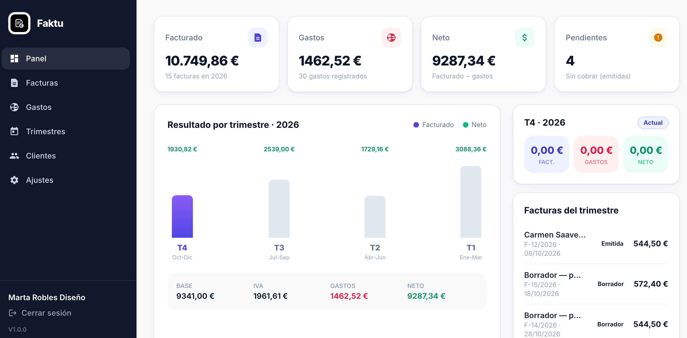
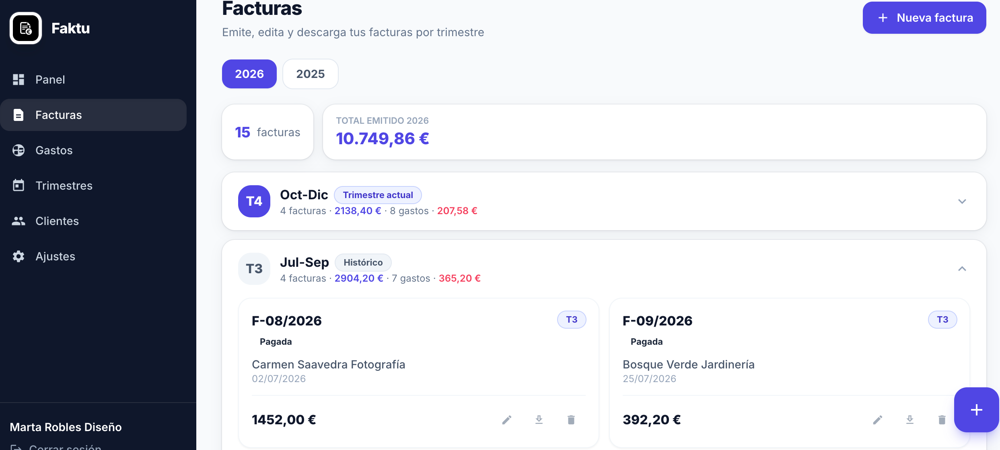
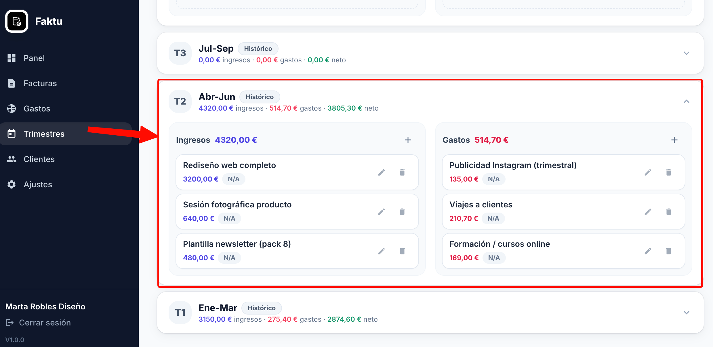
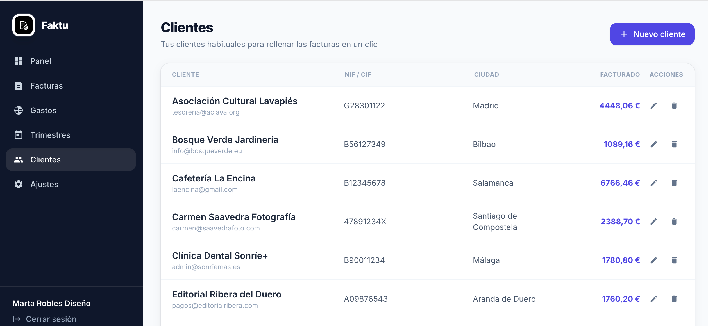
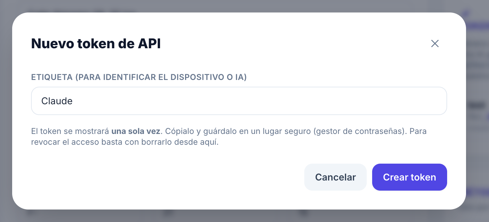
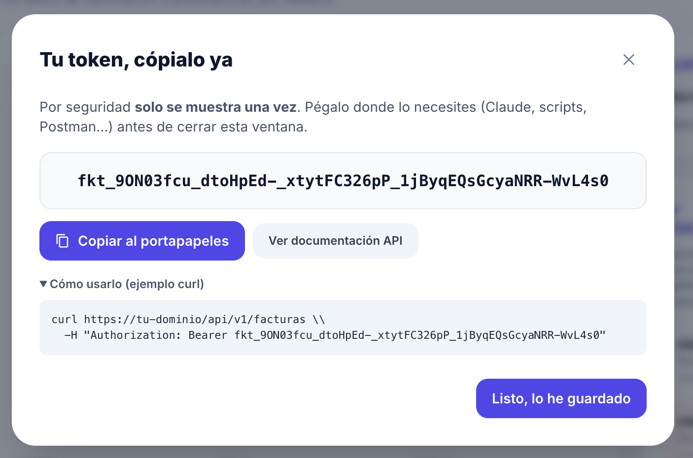
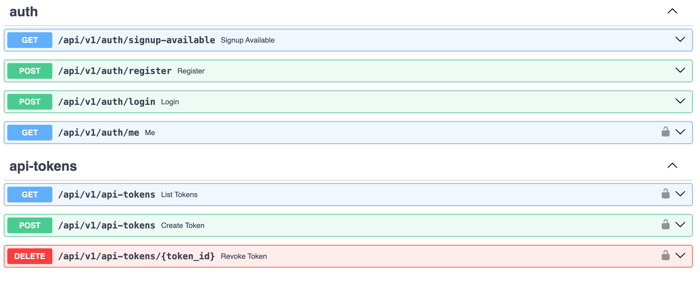
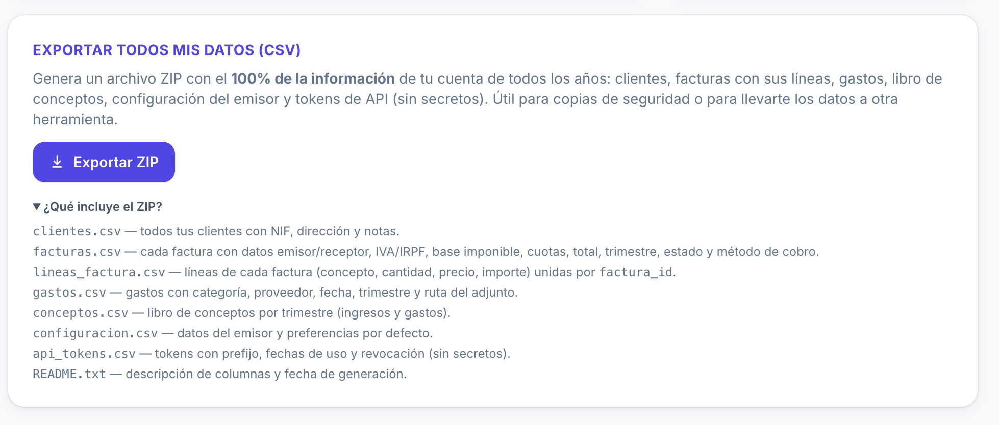

<p align="center"></p>

# Faktu

Gestión de **facturas** y **gastos** para autónomos, organizados por
trimestres y listos para presentar el modelo 303/130. SPA en español,
responsive (escritorio y móvil).

## Capturas

| | |
|---|---|
|  |  |
|  |  |

Generadas desde la cuenta de demo que crea `scripts/seed_demo.py`
(`demo@faktu.app` / `demo1234`).

## Token de API y exportación

| | |
|---|---|
|  |  |
| *Token de API desde Ajustes → Token API / IA* | *Claude u otra IA operando la cuenta con el token* |
|  |  |
| *Documentación interactiva en `/docs`* | *Exportación del 100% de los datos en un ZIP de CSVs* |

## Funcionalidades

- Autenticación con JWT, multi-cuenta y datos aislados por usuario.
- Facturas con líneas, IVA e IRPF configurables, total en vivo, PDF al vuelo.
- Numeración automática por año (`01/2026`, `02/2026`…).
- Gastos con categoría, proveedor y adjunto (descarga autenticada).
- Vista por trimestres: actual primero, pasados después, futuros al final.
- Libro de conceptos por trimestre con exportación a Excel.
- Dashboard anual con KPIs, gráfico por trimestres y actividad reciente.
- Clientes con total facturado acumulado y vínculo directo a la factura.
- Configuración del emisor para autocompletar datos en cada factura.
- Token de API personal para integrar con IAs (Claude, scripts, Postman…).

**Stack**: FastAPI · SQLAlchemy 2 (async) · Pydantic v2 · Alembic · PyJWT · bcrypt · Reportlab · SQLite (cambiable a Postgres).

## Despliegue con Dockerfile

Build y arranque en un solo comando (la imagen incluye la migración Alembic
en el `CMD`, así que el esquema queda al día al primer arranque):

```bash
docker build -t faktu .
docker run -d --name faktu --restart unless-stopped -p 8000:8000 \
  -v faktu-data:/data \
  -e SECRET_KEY="$(python -c 'import secrets; print(secrets.token_urlsafe(48))')" \
  -e DATABASE_URL=sqlite+aiosqlite:////data/faktu.db \
  -e AUTO_CREATE_TABLES=false \
  -e MEDIA_DIR=/data/media \
  faktu
```

Datos y adjuntos viven en el volumen `faktu-data` (`/data/faktu.db` y
`/data/media/...`). Para actualizarla: `docker build -t faktu .` y
`docker restart faktu`.

Variables de entorno relevantes:

- `SECRET_KEY` — **obligatorio cambiarla**. Genera una con
  `python -c "import secrets; print(secrets.token_urlsafe(48))"`.
- `AUTO_CREATE_TABLES=false` — recomendado en producción (las migraciones se
  ejecutan al arrancar vía `CMD`).
- `DATABASE_URL` — SQLite por defecto (`sqlite+aiosqlite:////data/faktu.db`).
  Cambia a Postgres si necesitas concurrencia o backups serios:
  `postgresql+asyncpg://faktu:faktu@db:5432/faktu` (y monta el host de la BD
  mediante tu orquestador).
- `MEDIA_DIR=/data/media` — ruta interna del contenedor donde se guardan los
  adjuntos de gastos.

Detrás de un proxy inverso (Caddy/Nginx/Traefik) apúntalo a `localhost:8000`
y reenvía los headers `Host` y `X-Forwarded-Proto` al contenedor.

## Desarrollo local

```bash
python3.12 -m venv .venv && source .venv/bin/activate
pip install -r requirements.txt
cp .env.example .env
alembic upgrade head
uvicorn app.main:app --reload
```

Abre `http://127.0.0.1:8000`. En desarrollo (`AUTO_CREATE_TABLES=true`) las
tablas se crean solas al arrancar.

## Tests

```bash
pip install -r requirements-dev.txt
pytest
```

## API y token para IAs

La API REST vive bajo `/api/v1` y está documentada en `/docs` (Swagger) y
`/redoc`.

En **Ajustes → Token API / IA** se generan tokens personales
(`fkt_<prefijo>_<secreto>`) con los mismos permisos que tu sesión. Se muestran
una sola vez y se pueden revocar individualmente. Uso:

```bash
curl https://tu-dominio/api/v1/facturas \
     -H "Authorization: Bearer fkt_<prefijo>_<secreto>"
```

Endpoints: `GET/POST /api/v1/api-tokens`, `DELETE /api/v1/api-tokens/{id}`.

## Estructura

```
app/
  main.py            # app FastAPI, routers, estáticos, SPA fallback
  core/              # config, db, seguridad, dependencias
  models/            # ORM (User, Cliente, Factura, Linea, Gasto, Config, ApiToken, Concepto)
  schemas/           # Pydantic v2
  api/routes/        # auth, clientes, facturas, gastos, trimestres, conceptos, dashboard, api-tokens, version
  services/          # numeración, PDF, Excel, seeding
  static/            # SPA estática (HTML/CSS/JS)
alembic/             # migraciones
scripts/             # seed_demo.py y otros
tests/               # pytest + httpx (ASGI)
```
